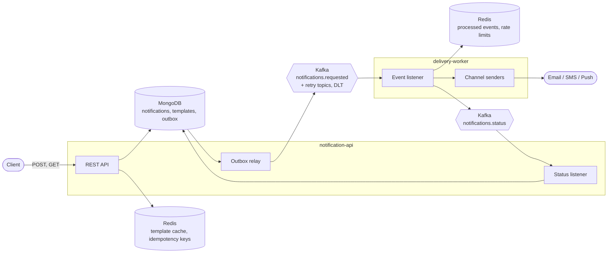
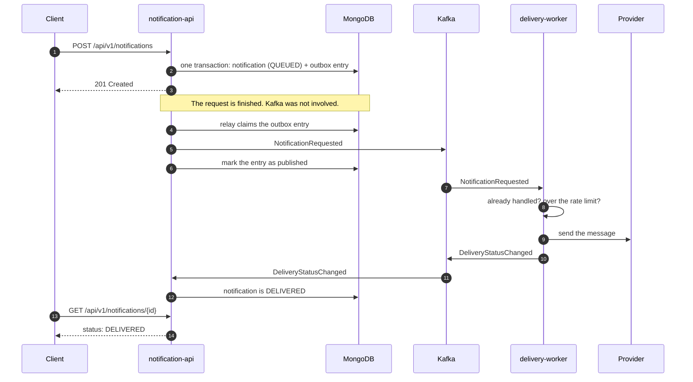

# java-notification-platform

[](https://github.com/khaledX5/java-notification-platform/actions/workflows/ci.yml)


**An event-driven notification platform. One HTTP request goes in, one email, SMS or push message comes out, and nothing is lost or sent twice on the way.**

Two Spring Boot services talk over Kafka. `notification-api` accepts a request and answers at once. `delivery-worker` sends the message and reports back how it went. The interesting part is everything that can go wrong in between, and what the code does about it.

```text
client ──HTTP──▶ notification-api ──▶ Kafka ──▶ delivery-worker ──▶ email / SMS / push
                        ▲                              │
                        └────────── Kafka ◀────────────┘   delivered or failed
```

---

## Contents

- [Why I built it](#why-i-built-it)
- [What it does](#what-it-does)
- [Quick start](#quick-start)
- [Architecture](#architecture)
- [The life of one notification](#the-life-of-one-notification)
- [API](#api)
- [Design decisions and trade-offs](#design-decisions-and-trade-offs)
- [Observability](#observability)
- [Testing](#testing)
- [Project structure](#project-structure)
- [Configuration](#configuration)
- [Development](#development)
- [Limitations](#limitations)

---

## Why I built it

Sending a notification looks like one line of code. It stops being one line as soon as you ask what happens when things fail:

- The client's request times out. Did the notification go out? If the client tries again, does the customer get two emails?
- The notification is saved, and the service crashes before the event reaches Kafka. Who sends it now?
- The SMS provider is down for a minute. Is every message in that minute lost?
- Kafka delivers the same event twice after a rebalance. Is the email sent twice?
- A bug in a caller sends one person 500 messages. Does anything stop it?

Every backend that sends messages over a broker has to answer these questions. This project is my answer to each of them, in a system small enough to read in an afternoon, with tests that prove every answer against real infrastructure.

It uses the stack I work with: Java, Spring Boot, Kafka, MongoDB and Redis.

## What it does

| Problem | What the platform does |
| --- | --- |
| A slow provider would block the caller | The API only stores the request and answers. Delivery happens later, in the worker. |
| The client repeats a request | An `Idempotency-Key` header: the repeat gets the first notification back, not a second one. |
| The event could be lost between the database and Kafka | A transactional outbox: the notification and its event are stored in one MongoDB transaction. |
| A provider is down for a while | Retry topics with a growing delay, then a dead-letter topic. Other messages keep flowing. |
| A message can never be delivered | It fails at once with a reason, without wasting retries. |
| Kafka hands out the same event twice | The worker remembers the result of every event and does not send again. |
| One recipient gets flooded | A token bucket per recipient and channel, kept in Redis by a Lua script. |
| The same text is sent again and again | Templates with placeholders, stored in MongoDB and cached in Redis. |
| "What happened to my notification?" | Every notification has a status, and one trace id follows it through both services. |

## Quick start

You need Docker. Nothing else.

```bash
git clone https://github.com/khaledX5/java-notification-platform.git
cd java-notification-platform
docker compose --profile app up -d --build
```

The first build takes a few minutes, because it compiles both services inside Docker. When it is done, six containers are running: Kafka, MongoDB, Redis, Mailpit (a fake email server) and the two services.

Send an email:

```bash
curl -i -X POST http://localhost:8080/api/v1/notifications \
  -H 'Content-Type: application/json' \
  -d '{"recipient": "dina@example.com", "channel": "EMAIL", "subject": "Order shipped", "body": "Your order is on its way"}'
```

```http
HTTP/1.1 201
Location: http://localhost:8080/api/v1/notifications/d731d05b-6534-4b84-bf98-1dfe412365fe

{"id":"d731d05b-6534-4b84-bf98-1dfe412365fe","recipient":"dina@example.com","channel":"EMAIL","subject":"Order shipped","body":"Your order is on its way","status":"QUEUED", ...}
```

Now look at what happened:

| Open | To see |
| --- | --- |
| The `Location` URL from the answer | The notification, which is `DELIVERED` by the time you look |
| http://localhost:8025 | The email, in the Mailpit inbox |
| http://localhost:8080/swagger-ui.html | The API, documented and ready to try |
| http://localhost:8080/actuator/prometheus | The metrics of the API (the worker has its own on port 8081) |

Stop everything with `docker compose --profile app down`.

## Architecture



| Module | What it is |
| --- | --- |
| `notification-api` | REST API. Stores notifications and templates, guards against repeated requests, and publishes events through the outbox. Listens for delivery results. |
| `delivery-worker` | Kafka consumer. Sends the message through the sender of its channel, retries, rate-limits, and reports the result. |
| `notification-events` | The event contracts both services share: two Java records and the topic names. No logic. |
| `end-to-end-tests` | Tests that run both services as separate processes. Not part of any service. |

Both services follow the same layout, a hexagonal architecture:

- **`domain`** and **`application`** hold the rules and the use cases. They know nothing about MongoDB, Kafka or Redis; they only know interfaces such as `Outbox`, `IdempotencyStore` or `ChannelSender`.
- **`infrastructure`** holds one adapter per technology (`mongo`, `redis`, `kafka`, `mail`, ...) that implements those interfaces.
- **`web`** holds the controllers and the error handling.

That is why the business logic is tested without Spring and without Docker, and why swapping the simulated SMS sender for a real gateway means writing one class.

## The life of one notification



A notification moves through these statuses and never goes back:

```text
QUEUED ──▶ DELIVERED
   └─────▶ FAILED      (with a failureReason)
```

## API

| Method | Path | What it does |
| --- | --- | --- |
| `POST` | `/api/v1/notifications` | Request a notification, with inline text or from a template |
| `GET` | `/api/v1/notifications/{id}` | Read a notification and its delivery status |
| `PUT` | `/api/v1/templates/{key}` | Create or replace a template |
| `GET` | `/api/v1/templates/{key}` | Read a template |

The full description, with every field and status code, is generated from the code: Swagger UI at `/swagger-ui.html`, OpenAPI JSON at `/v3/api-docs`.

### Templates

A template is text with `{{placeholders}}`.

```bash
curl -X PUT http://localhost:8080/api/v1/templates/order-shipped \
  -H 'Content-Type: application/json' \
  -d '{"subject": "Order {{orderId}} shipped", "body": "Hi {{name}}, order {{orderId}} is on its way."}'
```

```json
{"key":"order-shipped","subject":"Order {{orderId}} shipped","body":"Hi {{name}}, order {{orderId}} is on its way.","placeholders":["orderId","name"]}
```

### A request that is safe to repeat

Name the template, pass the variables, and add an `Idempotency-Key` that you choose:

```bash
curl -i -X POST http://localhost:8080/api/v1/notifications \
  -H 'Content-Type: application/json' \
  -H 'Idempotency-Key: order-1042-shipped' \
  -d '{"recipient": "dina@example.com", "channel": "EMAIL", "templateKey": "order-shipped", "variables": {"orderId": "A-1042", "name": "Dina"}}'
```

```http
HTTP/1.1 201
Location: http://localhost:8080/api/v1/notifications/19f553cb-c555-475b-b9b8-5262fc27e5fd

{"id":"19f553cb-c555-475b-b9b8-5262fc27e5fd","recipient":"dina@example.com","channel":"EMAIL","subject":"Order A-1042 shipped","body":"Hi Dina, order A-1042 is on its way.","status":"QUEUED", ...}
```

Run the same command again. You get the same notification back, no second email is sent, and the answer says so:

```http
HTTP/1.1 201
Location: http://localhost:8080/api/v1/notifications/19f553cb-c555-475b-b9b8-5262fc27e5fd
Idempotency-Replayed: true
```

### Errors

Every error is an [RFC 9457](https://www.rfc-editor.org/rfc/rfc9457) problem document (`application/problem+json`), so a client parses one format.

A request with invalid fields lists them:

```json
{"title":"Bad Request","status":400,"detail":"Invalid request content.","instance":"/api/v1/notifications",
 "errors":[{"field":"channel","message":"must not be null"},{"field":"recipient","message":"must not be blank"}]}
```

| Status | When |
| --- | --- |
| `400` | The body is malformed or a field is invalid |
| `404` | No notification or template with that id or key |
| `409` | The first request with this `Idempotency-Key` is still running |
| `422` | The request is well-formed but cannot be carried out: unknown template, missing variable, or an `Idempotency-Key` that was already used with a different body |
| `503` | The `Idempotency-Key` could not be checked; nothing was stored, so trying again is safe |

A notification that was accepted but can never be delivered is not an HTTP error. It ends as `FAILED`, with the reason:

```json
{"id":"579b7592-7059-47b0-9f8f-21a0cd8f0ab9","recipient":"not-a-phone-number","channel":"SMS","body":"Code 4821",
 "status":"FAILED","failureReason":"The recipient is not an E.164 phone number", ...}
```

## Design decisions and trade-offs

### 1. An outbox instead of writing to two systems

The obvious code saves the notification to MongoDB and then sends the event to Kafka. Those are two systems with no shared transaction, so it fails in two ways:

- Kafka is down: the request fails, although the database was fine.
- The service crashes between the two writes: the notification is stored forever as queued, and no event ever goes out.

Here the notification and its event are stored together, in **one MongoDB transaction**, the event in a collection called `outbox`. A relay then moves events from the outbox to Kafka:

- It claims the oldest waiting entry with a single `findAndModify`, which is atomic. Several API instances can run the relay side by side and never publish the same entry at the same time.
- It marks an entry as published only after Kafka confirmed it.
- A claim lasts 30 seconds. If the relay dies or the publish fails, the claim runs out and the entry is picked up again.

The result: a notification is accepted while Kafka is down, and none is ever stored without its event.

**Trade-offs.** The relay polls every 500 ms, so delivery starts up to half a second later than with a direct send. I chose polling over MongoDB change streams because it needs no extra moving parts; the `Outbox` interface would hide the switch if the load ever asked for it. And the outbox is *at-least-once*: an entry can be published twice. The next section deals with that.

### 2. At-least-once delivery, made safe three times

Nobody gets exactly-once delivery when the last step is an email leaving the building. What you can have is at-least-once delivery plus steps that are safe to repeat. There are three such steps:

| Where a duplicate comes from | What stops it |
| --- | --- |
| The client repeats a request | The `Idempotency-Key`, reserved in Redis with `SET NX` before the request runs |
| The outbox or Kafka delivers an event twice | The worker stores the result of each event id in Redis and checks it first |
| The worker reports a result twice | The API ignores a result for a notification that already has a final status |

Two details matter here.

The event id is the id of the outbox entry, so an entry that is published twice produces two events with the *same* id. That is what lets the worker recognise the repeat.

The worker stores the **result** of an event, not just "seen", and it stores it after sending and before reporting. If the report is lost, the event comes back, the worker finds the result, and it repeats only the report. Without this, a failing status publish made the worker send the same email on every retry.

**Trade-off.** There is one gap I know of and did not close. If the API crashes after storing a notification but before completing its idempotency key, the reservation expires after a minute, and a repeat after that creates a second notification. Closing it means keeping the key in MongoDB, in the same transaction as the notification. Redis was the simpler choice, and the gap is written down in the code.

### 3. Retries that do not block the queue

A failed delivery is not retried in place. That would hold up every message behind it on the partition for the length of the delay. Instead the event moves to a retry topic and is read again later:

```text
notifications.requested ──▶ -retry-0 ──▶ -retry-1 ──▶ -retry-2 ──▶ -dlt
                              2 s          6 s          18 s
```

After four attempts the event lands on the dead-letter topic, the notification is reported as `FAILED`, and the event stays there for inspection.

Not every failure is worth retrying. A malformed phone number will be malformed in 18 seconds too. Senders throw `UndeliverableException` for those, and the notification fails at once with the reason.

**Trade-off.** A retried event can be delivered after a newer one. Notifications are independent of each other, so that is fine here. It would not be fine for events that must stay in order.

### 4. Rate limiting as a token bucket in Redis

Each recipient has a bucket per channel: 10 messages at once, then one more every 6 seconds.

The bucket lives in Redis so that all worker instances share it. Reading the tokens and taking one has to be a single step, otherwise two workers both read "1 left" and both send. A Lua script gives that: Redis runs it as one atomic step. The script also uses the clock of Redis, so workers with drifting clocks still agree.

A message over the limit is not dropped. It goes through the retry topics and normally arrives a few seconds later.

I chose a token bucket over a fixed window, because a fixed window lets twice the limit through around the edge of the window.

### 5. What happens when Redis is down

Redis is used for four things, and they do not fail the same way. Each one was a decision:

| Used for | When Redis is down | Why |
| --- | --- | --- |
| Template cache | Read from MongoDB | A cache is an optimisation |
| Idempotency keys | The request is refused with `503` | Accepting it would silently drop the protection the client asked for. Requests without a key are not affected. |
| Processed events | The worker delivers anyway | A possible duplicate is better than no deliveries |
| Rate limit | The message is let through | A limit that is briefly off is better than a worker that stands still |

Redis commands time out after 2 seconds instead of the default 60, so "down" is noticed quickly.

### 6. One trace across the outbox

A trace normally follows the thread that handles a request. The outbox breaks that chain: the event is published later, by another thread, maybe on another instance.

So the trace of the request is stored with the outbox entry (as a W3C `traceparent` header) and resumed when the entry is published. From there Kafka carries it to the worker, through the retry topics as well, and back with the status event. One trace id shows the request, the delivery and the result.

## Observability

Both services expose Prometheus metrics at `/actuator/prometheus`, on top of what Spring Boot provides for HTTP, Kafka, MongoDB and the JVM.

| Metric | Service | What it tells you |
| --- | --- | --- |
| `notifications_accepted_total{channel}` | API | How much comes in |
| `notifications_idempotent_replays_total` | API | How often clients repeat requests |
| `notifications_outbox_events_total{result}` | API | Events published to Kafka, and failed attempts |
| `notifications_outbox_waiting` | API | Events not yet published. It should stay near zero; if it grows, the relay or Kafka has a problem. |
| `notifications_outbox_publish_seconds` | API | How long publishing an event takes |
| `notifications_completed_total{status}` | API | How notifications end: delivered or failed |
| `notifications_delivery_attempts_total{channel,result}` | Worker | Every attempt: `delivered`, `undeliverable`, `provider_failure`, `rate_limited`, `duplicate`, `abandoned` |

Tags only take values from small fixed sets. A recipient or an id is never a tag.

Every log line written while a notification is being handled carries its trace id, so one `grep` for that id shows the whole story of the notification in both services. Email addresses, phone numbers and message texts are kept out of the logs and out of Redis key names.

Health and readiness probes are at `/actuator/health/liveness` and `/actuator/health/readiness`.

## Testing

About 350 tests, on four levels. Nothing on the path under test is mocked from the integration level up.

| Level | Count | Runs against | What it proves |
| --- | --- | --- | --- |
| Unit | 261 | Plain Java, in-memory fakes | The business rules: status changes, idempotency, relay, deduplication, rate limiting |
| Integration | 87 | Real Kafka, MongoDB, Redis and SMTP in [Testcontainers](https://testcontainers.com) | Each adapter and each service on its own, including failure and recovery |
| End-to-end | 6 | Both services as separate processes, from their real jars | A request over HTTP ends as an email in an inbox |
| Smoke | 1 CI job | The images, started with `docker compose` | The Dockerfile and the compose file actually work |

Line coverage is 98% for the API and 97% for the worker, and the build fails if a module drops below 90%.

Some things I wanted proven, not assumed:

- **Atomicity of the outbox.** A test makes the outbox write fail and checks that the notification was not stored either.
- **Recovery.** The broker is made to fail, a notification is accepted anyway, and its event goes out once the broker is back.
- **Concurrency.** Twelve requests with the same idempotency key at the same moment create one notification. Eight relays claiming from forty entries never get the same one. Twelve workers asking a bucket of three get exactly three permits.
- **No second email.** The same event is delivered to the worker twice, and the fake inbox holds one message.

Run them:

```bash
./mvnw verify                            # everything; needs Docker for the integration and end-to-end tests
./mvnw test                              # unit tests only; no Docker needed
./mvnw -pl notification-api -am verify   # one module and what it depends on
```

The coverage report of each module is written to `target/site/jacoco/index.html`.

## Project structure

```text
.
├── notification-events/        Event records and topic names shared by both services
├── notification-api/
│   └── src/main/java/.../api/
│       ├── domain/             Notification, Template, their rules, repository interfaces
│       ├── application/        Use cases and ports: NotificationService, OutboxRelay, IdempotentRequests
│       ├── infrastructure/     Adapters: mongo, redis, kafka, scheduling, observability
│       └── web/                Controllers, request and response types, error handling
├── delivery-worker/
│   └── src/main/java/.../worker/
│       ├── application/        DeliveryService and its ports: ChannelSender, ProcessedEvents, DeliveryRateLimiter
│       └── infrastructure/     Adapters: kafka, mail, redis, simulated, observability
├── end-to-end-tests/           Both services as containers, tested from the outside
├── Dockerfile                  One multi-stage file for both services
├── compose.yaml                Infrastructure, plus the services under the "app" profile
└── .github/workflows/ci.yml    Build, tests, coverage, and the full-stack smoke test
```

## Configuration

The services read these environment variables. The defaults match `compose.yaml`, so nothing has to be set for local work.

| Variable | Used by | Default |
| --- | --- | --- |
| `KAFKA_BOOTSTRAP_SERVERS` | both | `localhost:9092` |
| `REDIS_HOST`, `REDIS_PORT` | both | `localhost`, `6379` |
| `MONGODB_URI` | API | `mongodb://localhost:27017/notifications` |
| `SMTP_HOST`, `SMTP_PORT` | worker | `localhost`, `1025` |
| `EMAIL_FROM` | worker | `no-reply@notifications.local` |

The behaviour described above is tuned in each service's `application.yml`:

| Setting | Default | Meaning |
| --- | --- | --- |
| `notifications.outbox.poll-interval` | `500ms` | Pause between two runs of the relay |
| `notifications.outbox.claim-duration` | `30s` | How long a relay keeps an entry to itself |
| `notifications.idempotency.ttl` | `24h` | How long a repeat gets the first notification back |
| `notifications.templates.cache-ttl` | `10m` | How long a template is served from Redis |
| `notifications.delivery.retry.attempts` | `4` | Tries per notification, the first one included |
| `notifications.delivery.retry.delay`, `.multiplier` | `2s`, `3` | First wait, and how it grows |
| `notifications.delivery.deduplication.ttl` | `24h` | How long the result of an event is remembered |
| `notifications.delivery.rate-limit.capacity` | `10` | Messages a recipient can get at once, per channel |
| `notifications.delivery.rate-limit.refill-interval` | `6s` | Time to earn one of them back |

MongoDB has to run as a replica set, because transactions need one. `compose.yaml` starts a single-node replica set for that reason.

## Development

You need JDK 21 and Docker. Maven comes with the wrapper.

```bash
docker compose up -d                 # infrastructure only
./mvnw -DskipTests package           # build both services

java -jar notification-api/target/notification-api-0.1.0-SNAPSHOT.jar
java -jar delivery-worker/target/delivery-worker-0.1.0-SNAPSHOT.jar
```

| Command | What it does |
| --- | --- |
| `./mvnw verify` | Format check, compiler warnings, all tests, coverage check |
| `./mvnw spotless:apply` | Format the code ([palantir-java-format](https://github.com/palantir/palantir-java-format)) |
| `docker compose --profile app up -d --build` | Run the whole platform in containers |

The build is strict on purpose: unformatted code, two versions of the same dependency, or a module below the coverage floor all fail it. Every change goes through a pull request, and CI has to be green before it is merged.

## Limitations

- **No authentication.** Anyone who can reach the API can use it, and idempotency keys are not scoped to a client. A real deployment would put this behind a gateway and add the client id to the key.
- **SMS and push are simulated.** They validate the recipient the way a gateway would (an E.164 number, a device token) and log the hand-over. Email is real SMTP. Each sender is one class behind the `ChannelSender` interface.
- **The idempotency gap** described in [section 2](#2-at-least-once-delivery-made-safe-three-times).
- **A permit is used up even if the send then fails.** The rate limiter does not give it back.
- **Length limits apply to the request**, not to the text after a template was filled in.
- **Traces are not exported.** The ids are created, propagated and logged, but there is no collector in `compose.yaml`.

## License

[MIT](LICENSE)
